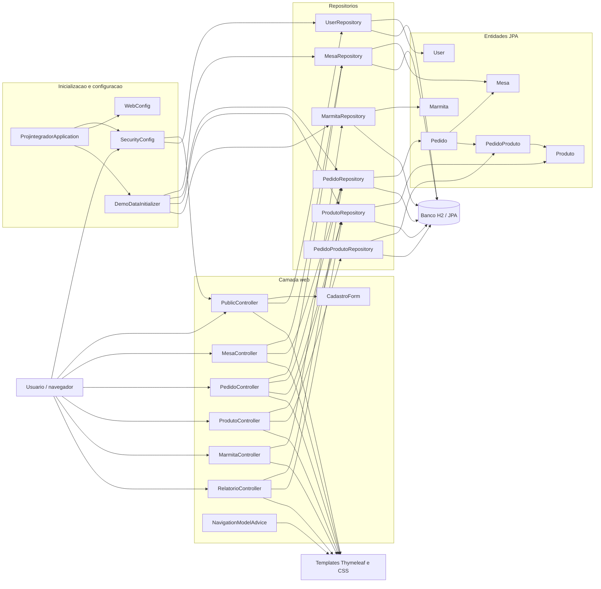
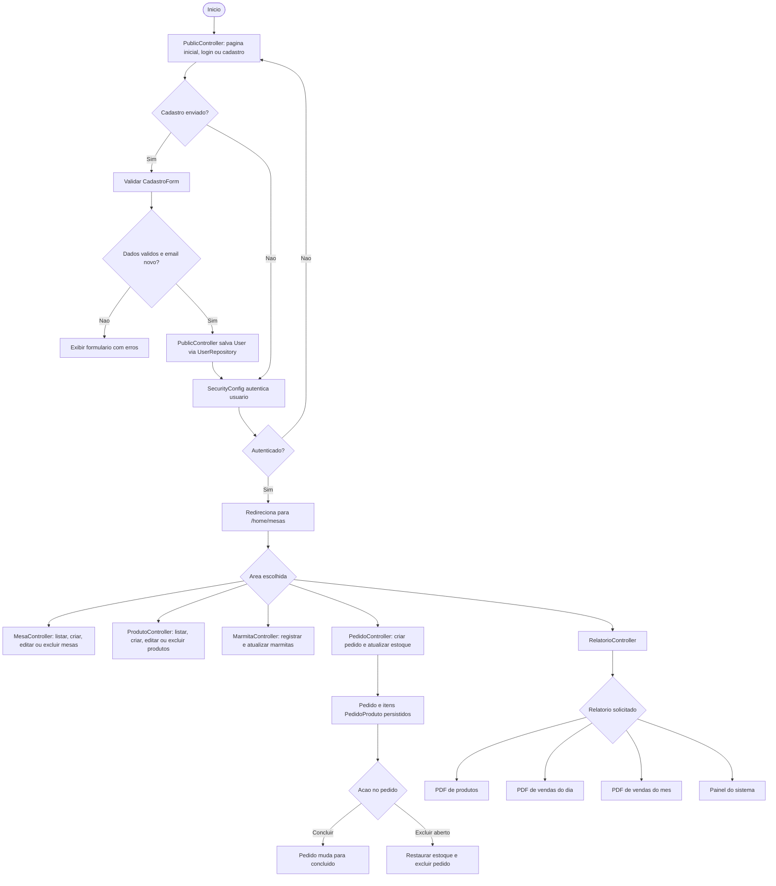
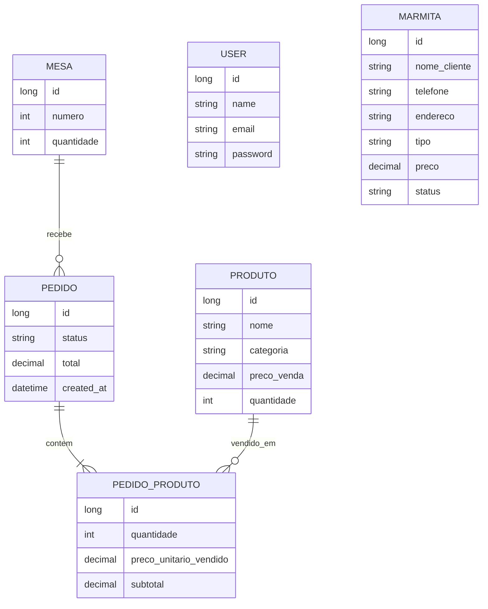

# Fluxograma e classes do projeto

Este documento resume o fluxo do sistema Mesa & Sabor e identifica a responsabilidade de cada classe Java. As setas indicam uso ou relacionamento entre classes.

## Arquitetura e dependências

## Fluxo de uso

## Classes, uma por uma

### Inicializacao e configuracao

| Classe | Responsabilidade |
|---|---|
| `ProjintegradorApplication` | Inicia a aplicacao Spring Boot. |
| `SecurityConfig` | Configura o BCrypt, carrega usuarios pelo `UserRepository`, protege rotas e define login e logout. |
| `WebConfig` | Ponto de configuracao para ajustes adicionais do Spring MVC; atualmente nao declara regras extras. |
| `DemoDataInitializer` | Quando `app.demo-data.enabled=true`, popula o banco vazio com mesas, produtos, marmitas e pedidos de demonstracao. |
| `DemoDataInitializer.ItemPedido` | Record interno usado para agrupar um produto e a quantidade durante a criacao dos dados de demonstracao. |

### Controllers e formulario

| Classe | Responsabilidade e dependencias |
|---|---|
| `PublicController` | Exibe inicio, login e cadastro; valida o formulario, verifica email duplicado, codifica a senha e salva o usuario. Usa `UserRepository`, `PasswordEncoder` e `CadastroForm`. |
| `NavigationModelAdvice` | Disponibiliza o caminho HTTP atual como `currentPath` para os templates destacarem a secao ativa do menu. |
| `MesaController` | Lista, cria, edita e exclui mesas. Impede alteracao do ID e bloqueia exclusao de mesa que tenha pedidos. Usa `MesaRepository` e `PedidoRepository`. |
| `PedidoController` | Lista pedidos abertos, cria pedido com itens, valida estoque, atualiza quantidades, conclui ou exclui pedidos abertos. Usa `PedidoRepository`, `MesaRepository` e `ProdutoRepository`. |
| `ProdutoController` | Lista, cria, edita e exclui produtos; impede alterar ID e nao permite excluir produto associado a item de pedido. Usa `ProdutoRepository` e `PedidoProdutoRepository`. |
| `MarmitaController` | Lista, cria, edita e exclui registros de marmitas. Usa `MarmitaRepository`. |
| `RelatorioController` | Exibe relatorios e painel e gera PDFs de produtos, vendas do dia e vendas do mes. Usa `ProdutoRepository` e `PedidoRepository`. |
| `CadastroForm` | Objeto de formulario de cadastro com validacoes de nome, email e senha. |
| `RelatorioController.ReportFooter` | Classe interna que desenha o rodape e o numero da pagina nos PDFs. |

### Repositorios

| Classe | Entidade e operacoes especificas |
|---|---|
| `UserRepository` | Acesso JPA a `User`; busca usuario por email com `findByEmail`. |
| `MesaRepository` | Acesso JPA a `Mesa`; verifica numero duplicado e numero duplicado ignorando um ID. |
| `PedidoRepository` | Acesso JPA a `Pedido`; lista por status e verifica se uma mesa possui pedidos. |
| `PedidoProdutoRepository` | Acesso JPA a `PedidoProduto`; verifica se um produto esta associado a um item de pedido. |
| `ProdutoRepository` | Acesso JPA a `Produto`; busca produtos por IDs com bloqueio pessimista para proteger atualizacao de estoque em pedidos concorrentes. |
| `MarmitaRepository` | Acesso JPA a `Marmita`; usa as operacoes CRUD herdadas de `JpaRepository`. |

### Entidades

| Classe | Dados principais e relacionamentos |
|---|---|
| `User` | Usuario autenticavel com nome, email unico e senha codificada. |
| `Mesa` | Mesa com numero unico e quantidade de lugares. |
| `Produto` | Produto com nome, categoria, preco de compra, preco de venda e quantidade em estoque. |
| `Marmita` | Pedido de marmita para cliente, com telefone, endereco, tipo, preco e status. |
| `Pedido` | Pedido de uma `Mesa`, com status, total, data de criacao e lista de `PedidoProduto`. |
| `PedidoProduto` | Linha de pedido que relaciona um `Pedido` e um `Produto`, guardando quantidade, preco unitario vendido e subtotal. |

## Relacionamentos entre entidades

`User` e `Marmita` nao possuem relacionamento JPA com as demais entidades no codigo atual.
